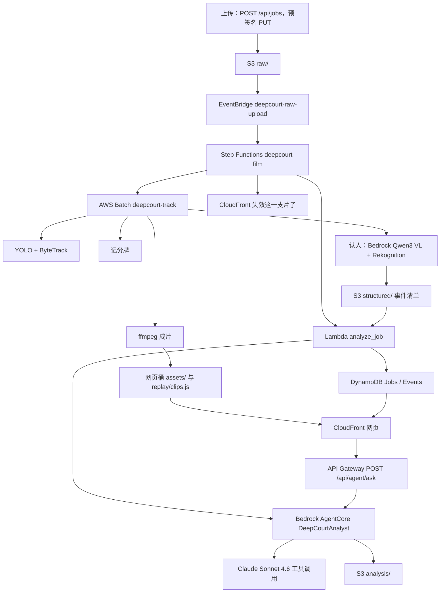

# Deep Court

Team 04 · NBA × AWS Broadcast Code 12H · 珠海初赛 / 澳门决赛

**一句话：** Deep Court 读取一段 NBA 比赛视频和官方深度数据，在云上生成带记分牌、人名和数据的回放。分析师跑在 Amazon Bedrock AgentCore 上，观众从 Amazon CloudFront 打开成片。

价值主张：让每一次出手被重新讲述一遍——深度数据驱动的 AI 增强比赛画面。

## 我们的初心：让更多人看懂 NBA

篮球很好看，但对第一次看球的人来说，屏幕上满是号码、术语和一闪而过的数据，很难跟上。Deep Court 想做的不只是给老球迷更深的数据，更希望让从来没看过 NBA 的人，也能看懂一场比赛、喜欢上一支球队。

所以打开作品时，我们会先问一句「你想怎么看这段比赛」，其中专门留了一个给新观众的选项：带新球迷一起看。不管是陪女朋友、陪家里的孩子，还是带第一次看球的朋友，都可以选它。

选「带新球迷一起看」试试：[`/game.html?mode=daikan`](web/game.html?mode=daikan)。

### 1. 看得懂：用简单的符号代替术语

- 球员有多强，直接画成五颗星：在队里排第一就是五颗星，每往后一名少半颗，不用懂数据也能一眼看出谁是核心。
- 每个术语配一句白话解释，比如「盖帽」就是把对手投出去的球打掉。
- 盖帽、3+1 这样的精彩瞬间，进球之后会再慢放回放至少 10 秒，配上数据卡，告诉你这球到底难在哪：比如这一投的预期命中率只有三成，他还是投进了。

### 2. 记得住：喜欢上一支球队，就别错过下一场

- 看完这段比赛喜欢上哪支球队，可以直接订阅这支球队 2026–27 赛季的全年赛程，下一场什么时候打一目了然。独行侠是 [`schedules/dal-2026-27.ics`](web/schedules/dal-2026-27.ics)，火箭是 [`schedules/hou-2026-27.ics`](web/schedules/hou-2026-27.ics)。

### 3. 跟得上：从看一场，到每一场都不错过

- 页面上提供 NBA 官方的 [League Pass](https://www.nba.com/league-pass-purchase) 入口，以及国内的 [腾讯视频](https://v.qq.com/channel/nba) 订阅入口，看完这场，接下来的每一场都能接着看。
- 还可以直接买到球衣等球队周边，把喜欢变成支持。[独行侠周边](https://store.nba.com/dallas-mavericks/t-25921725+z-9808307-1099833793)、[火箭周边](https://store.nba.com/houston-rockets/t-25701720+z-9900621-3740132585)。

我们相信，数据和 AI 不只是让专家看得更深，也能让新观众第一次就看懂、看进去。这就是 Deep Court 的初心。

## 和社交媒体联动：一键分享精彩瞬间

系统会自动截取播放器里当前这一帧。用户点击播放器下方的分享区，就能跳转到与 NBA 正式合作的 5 个官方平台的作品发布页，和其他球迷分享比赛的精彩瞬间。五个入口都在 `web/game.html` 的分享区，用 `data-share` 区分：快手（`kuaishou`）、哔哩哔哩（`bilibili`）、视频号（`wechat`）、微博（`weibo`）、抖音（`douyin`）。由于各平台的开发者接口还在申请中，这次先做了分享入口，接口开通后即可直接发布。

| | |
| --- | --- |
| 成片 | https://d2vzd2batw1eqe.cloudfront.net/ |
| 作品页 | https://d2vzd2batw1eqe.cloudfront.net/readme |
| 队名 | Team 04。页面上能看见，不只有仓库名。 |
| 区域 | 全部 `us-east-1` |
| 栈 | `Team04DeepCourt` |
| 部署账号 | `382918437747`（profile `nba`） |

根路径打开的是回放页 `game.html`：成片、时间线、音轨。`/readme` 由 CloudFront Function `ReadmePath` 指到 `readme.html`。`/index.html` 是自己用的上传页。提交链接用根路径。

回放页有三种观看方式，写在 `web/game.js` 的 `MODES`：`laofan` 老球迷、`xinfan` 新球迷、`daikan` 带新球迷一起看。按钮在 `web/game.html`。地址带 `?mode=` 时直接进入；没带时先问「你想怎么看这段比赛」。老球迷不显示术语白话。带看这一档放球员头像、两队 2026–27 赛程（`schedules/dal-2026-27.ics`、`schedules/hou-2026-27.ics`）、NBA League Pass（`https://www.nba.com/league-pass-purchase`）、腾讯视频（`https://v.qq.com/channel/nba`），以及两队 NBA Store。队内排名画成星：第 1 名五颗星，每往后一名少半颗，最少半颗（`pipeline/enrich/defense.py` 的 `stars`）。`web/config.js` 的 `examOnly: true` 让切换列表只留考试片，训练片和样片 `flagg`、`amen`、`warm-probe`、`rehearsal` 隐藏，文件仍在；考试片还没到时页面写「考试片生成中」。`webNames: false` 时网页不再叠画名签，只用成片里烧进去的一层。这版播放器脚本还没换上 CloudFront。状态：代码已就绪，待部署。线上仍是较早的「解说向 / 陪女友观看」。

步骤和每个服务的当前状态以 [docs/pipeline-map.md](docs/pipeline-map.md) 为准。服务为什么在，见 [docs/architecture.md](docs/architecture.md)。从干净账号重跑的开关和「默认部署不会替换哪些资源」，见 [docs/deploy.md](docs/deploy.md)。

## 硬性要求

| 要求 | 落在哪 |
| --- | --- |
| Bedrock AgentCore 承载智能体 | 运行时 `DeepCourtAnalyst`，入口 `agent/agent.py`，CDK `cdk/lib/deepcourt-stack.ts` 的 `AnalystRuntime` |
| CloudFront 发布，并且是 Web 页面 | 分配 `Site`，域名 `d2vzd2batw1eqe.cloudfront.net`。打开就能看成片 |
| AWS CDK 定义基础设施 | 一个栈 `Team04DeepCourt`，代码在 `cdk/` |
| 托管 / 无服务器 / 事件驱动 / 基础设施即代码 | Lambda、API Gateway、DynamoDB、S3、EventBridge、Step Functions、Batch、CloudFront，全部由 CDK 描述 |

交付物是这个 Web 页面，加上本仓库、说明、演示视频和上面的 CloudFront 链接。页面默认就能看懂；暂停和点击展开更深的一层。

## 架构

仓库里的编排是一条状态机：成片在同一台 Batch 机器上完成，然后状态机才调用分析师。分析师读的是已经写好的事件清单。这条状态机的状态是部署中，见下一节。



观众提问走网站的 `/api/agent/ask`。CloudFront Function `StripApiPrefix` 去掉 `/api`，API Gateway 上的路径是 `POST /agent/ask`。还是同一个运行时，不另写一套回答。

状态机 `deepcourt-film` 和这次 AgentCore 入口修复的状态是**部署中**：代码在仓库里，还没有用这份模板执行 `cdk deploy`。线上已经能打开 CloudFront 站点；Batch 追踪、认人、成片已经接通，见下一节。考试片仍走已经部署的作业定义。

## 每个服务用在哪

状态只用这几个词：主路径、已接通、本地、配额挡住、部署中。探测过、但主路径没换，写成已接通。

| 服务 | 用在哪 | 代码 | 状态 |
| --- | --- | --- | --- |
| CloudFront | 作品链接。默认对象 `game.html`。`/readme` 指到 `readme.html`。`/api/*` 转到 API Gateway 阶段 `prod`。网页桶不公开，只经 OAC 读 | `cdk/lib/deepcourt-stack.ts` 的 `Site`、`ReadmePath`、`StripApiPrefix`、`DeployWeb` | 主路径。分配 `d2vzd2batw1eqe.cloudfront.net`，`/` 和 `/readme` 已能打开 |
| S3 媒体桶 | `raw/` 原片，`structured/` 事件清单，`official/` 逐回合，`identity/` 认人，`analysis/` 解说，`tracking/` 轨迹，`bootstrap/track/` 作业脚本 | `cdk/lib/deepcourt-stack.ts` `MediaBucket`。线上桶名 `team04deepcourt-mediabucketbcbb02ba-haisfxujonfg` | 主路径 |
| S3 网页桶 | 静态站、`assets/{jobId}-*.mp4`、`replay/clips.js` | 同上 `WebBucket` | 主路径 |
| API Gateway | REST `JobsApi`：`POST /jobs`，`GET /jobs/{id}`，`GET /jobs/{id}/events`，`POST /agent/ask`，`GET /agent/analysis/{jobId}`。浏览器走 CloudFront 的 `/api` 前缀 | `cdk/lib/deepcourt-stack.ts` | 主路径（建任务和回放）。`/agent/ask` 与 `/agent/analysis/{jobId}` 随这次分析师部署一起上，状态是部署中 |
| Lambda `create_job` | 写 Jobs 表，返回 1 小时预签名 PUT。不启动状态机，避免文件还没传完就跑 | `lambdas/create_job/handler.py` | 主路径 |
| Lambda `get_job` / `list_events` | 回放页轮询状态和事件 | `lambdas/get_job/handler.py`，`lambdas/list_events/handler.py` | 主路径 |
| Lambda `analyze_job` | 把 `structured/{jobId}.json` 交给 AgentCore。运行时没起来时，自己读清单，把页面事件写入 DynamoDB。清单校验失败则把任务写成 FAILED | `lambdas/analyze_job/handler.py`，`lambdas/agent_client.py` | 主路径（事件写入）。叫醒分析师的这次运行时修复是部署中 |
| Lambda `ask_agent` | `POST /agent/ask` 转发问题。`GET /agent/analysis/{jobId}` 读已经写好的解说 | `lambdas/ask_agent/handler.py` | 部署中。代码在仓库和这次 CDK 模板里，还没有用这份模板执行 `cdk deploy` |
| DynamoDB | `JobsTable` 分区键 `jobId`。`EventsTable` 分区键 `jobId`、排序键 `TS#序号` | `cdk/lib/deepcourt-stack.ts` | 主路径 |
| EventBridge | 只有媒体桶 `raw/` 的对象创建会启动状态机。规则名 `deepcourt-raw-upload` | `cdk/lib/orchestration.ts` | 部署中 |
| Step Functions | 标准工作流 `deepcourt-film`：任务改成 TRACKING，`SubmitJob.sync` 等到 Batch 结束，调用 `analyze_job`，核对成片和 `replay/clips.js`，失效这一支片子的四条路径，写成 DONE。失败写成 FAILED。重复上传停在 `DuplicateSkipped` | `cdk/lib/orchestration.ts` | 部署中。`-c enableOrchestration=false` 时不建，`raw/` 和 `structured/*.json` 仍通知 `analyze_job` |
| AWS Batch | 队列 `deepcourt-track`。计算环境 `c7i.48xlarge`，最低 192 vCPU，上限 256。镜像 `deepcourt-tracker:ready`。同一台机器做追踪、记分牌、认人、清单、ffmpeg | `cdk/lib/p1.ts`，容器入口 `inference/run_job.py` | 已接通。G/VT 配额为 0，GPU 路径配额挡住，所以走这台 CPU 机器 |
| ECR | 仓库 `deepcourt-tracker`。默认作业定义仍指向已经烤好的 `:ready` | `cdk/lib/p1.ts`。镜像烘焙脚本 `inference/bake.sh` | 已接通。默认部署不重建这枚镜像 |
| 追踪 | YOLO 检测 + ByteTrack，一次看 16 帧 | `inference/track.py`，权重在媒体桶 `bootstrap/models/`，不在 git 里 | 已接通。本机 MPS 仍能出训练片 |
| 记分牌 | 读节次、比赛钟、进攻钟、比分 | 考试片 `pipeline/vision/scoreboard.py`，作业从镜像里的 `/opt/track/vision` 加载（`inference/run_job.py`） | 已接通。训练片主路径仍在本地 |
| Amazon Textract | `DetectDocumentText`。认人只在 Qwen 调用失败时用它兜底 | `inference/chain.py`；探测用的 Lambda 在 `lambdas/ocr_scoreboard/` | 已接通（探测）。记分牌主路径不走 Textract |
| Amazon Bedrock Qwen3 VL | 认人：号码、球衣颜色、是不是裁判。模型 `qwen.qwen3-vl-235b-a22b` | `inference/chain.py`。作业角色的 `bedrock:InvokeModel` 在 `cdk/lib/p1.ts` | 已接通 |
| Amazon Rekognition | `DetectText`，认人的第二票 | `inference/chain.py`，权限在 `cdk/lib/p1.ts` | 已接通 |
| ffmpeg | 云上成片把记分牌烧进 `assets/{jobId}-broadcast.mp4`，原声留下，不烧人名 | `inference/run_job.py` | 已接通。`assets/warm-probe-broadcast.mp4` 已在网页桶 |
| AWS Elemental MediaConvert | 模板 `deepcourt-render-template`，设计上把叠加层合成到 `rendered/` | `cdk/lib/p1.ts` | 已接通（模板在栈里）。还没有提交转码作业，成片是上面的 ffmpeg |
| Amazon Bedrock AgentCore | 运行时 `DeepCourtAnalyst`。Python 3.12，入口 `agent.py`，监听 8080 的 `/ping` 和 `/invocations`。Lambda 用 `bedrock-agentcore:InvokeAgentRuntime` 调用 | `agent/agent.py`，`cdk/lib/deepcourt-stack.ts` `AnalystRuntime` | 部署中。见下面「智能体」 |
| Amazon Bedrock Converse | 分析师的工具循环。模型 `global.anthropic.claude-sonnet-4-6`，温度 0 | `agent/converse_loop.py`，工具在 `agent/tools.py` | 部署中（随这次运行时一起上） |
| Secrets Manager | `deepcourt/feishu-webhook`、`deepcourt/github-token`、`deepcourt/kuaishou`。部署时生成空占位，真实值不进仓库 | `cdk/lib/p2.ts`，读取代码 `lambdas/runtime_secrets.py` | 已接通。密钥仍是空占位 |
| CloudWatch / X-Ray | 仪表盘 `deepcourt-overview`，告警 `deepcourt-bedrock-throttles`，Lambda 日志保留 7 天。`enableP2` 打开时 API 和 Lambda 追踪 | `cdk/lib/p1.ts`，`cdk/lib/p2.ts`，`cdk/lib/orchestration.ts`，`lambdas/trace_job.py` | 已接通。成本分配标签激活被拒绝 |
| 快手 OAuth | `GET /oauth/kuaishou/start` 和 `/callback`。没有 app_id 时只返回敬请期待 | `lambdas/kuaishou/` | 代码在。业务未接通 |
| Amazon Cognito | 回放和上传不登录 | 不建 | 不在这条管道里 |

预置桶 `nba-hackathon-382918437747-team04` 只放过探测对象。它不是媒体桶，也不是网页桶。

训练片的领防、脱手帧和赛季对位仍在本机：`pipeline/events/`、`pipeline/vision/release.py`、`pipeline/vision/backtrack.py`、`pipeline/enrich/`。状态是本地。

## 智能体

分析师的名字是 DeepCourtAnalyst。它自己决定先查哪一项，再写中英文解说、定格卡上的一句话，和最多三条亮点。每句话的数字和人名必须来自工具结果。工具里没有的，不说。

工具在 `agent/tools.py`：

| 工具 | 读什么 |
| --- | --- |
| `read_manifest` | `structured/{jobId}.json` |
| `validate_manifest` | 清单格式：`version` 为 `0.1`，`possessions` 非空，进攻方只能是 HOU 或 DAL |
| `read_official` | 媒体桶 `official/2025-26/` 的逐回合和 shot quality |
| `read_season` | 2025-26 赛季火箭、独行侠的攻防三区。只打包了这两队，文件 `agent/season_hou_dal.json` |
| `read_identity` | `identity/{jobId}.json` 里已经写出的姓名、球队和号码 |

落地校验在 `agent/grounding.py`：句子里的数字和人名对不上工具结果，就留不下来。查不到时问答模式回答「工具里没有足够的数据来回答这个问题。」管道模式若没有亮点，就写「这段没有更多能对上官方或赛季数据的看点。」

### AgentCore 收到的 payload

Lambda 通过 `invoke_agent_runtime` 把 JSON 放进 `payload`（`lambdas/agent_client.py`）。会话 ID 取 jobId 里的字母数字，补到 33–40 位；问答会话前面加 `q`。`qualifier` 为 `DEFAULT`。

运行时自己的 HTTP 入口在 `agent/agent.py`：`GET /ping`，`POST /invocations`。`/ping` 返回 `{"status":"Healthy","time_of_last_update": <unix 秒>}`。

管道模式（`analyze_job` 传入，没有 `question`）：

```json
{
  "jobId": "warm-probe",
  "bucket": "team04deepcourt-mediabucketbcbb02ba-haisfxujonfg",
  "key": "structured/warm-probe.json"
}
```

`key` 可以省略，运行时会补成 `structured/{jobId}.json`。成功时运行时返回：

```json
{
  "ok": true,
  "error": "",
  "stream": { "version": "0.1", "possessions": [] },
  "runtime": "bedrock-agentcore",
  "mode": "pipeline",
  "analysis": {
    "version": "1",
    "jobId": "warm-probe",
    "mode": "pipeline",
    "model": "global.anthropic.claude-sonnet-4-6",
    "possessions": [
      {
        "possessionId": "p0",
        "commentaryZh": "解说中文",
        "commentaryEn": "English line",
        "sources": ["structured/warm-probe.json"]
      }
    ],
    "shots": [
      {
        "t": 12.4,
        "freezeZh": "定格卡一句话",
        "freezeEn": "One freeze line",
        "commentaryZh": "出手解说",
        "commentaryEn": "Shot line",
        "sources": ["official/2025-26/games/0022500356_playbyplay.json"]
      }
    ],
    "highlights": [
      { "zh": "看点", "en": "Highlight", "sources": ["season:2025-26:DAL:Cooper Flagg"] }
    ]
  }
}
```

这份 `analysis` 会写到媒体桶 `analysis/{jobId}.json`。清单校验失败时不写解说，返回：

```json
{
  "ok": false,
  "reason": "invalid_manifest",
  "error": "进攻方不是 HOU/DAL",
  "stream": null,
  "runtime": "bedrock-agentcore",
  "mode": "pipeline"
}
```

缺少 `bucket` 或 `jobId` 时：`{"ok":false,"error":"缺少 bucket 或 jobId","runtime":"bedrock-agentcore"}`。payload 不是 JSON：`error` 为 `payload 不是 JSON`。

上面的解说句子是字段形状，用来对照代码，不是某次线上调用的原文。

### `POST /api/agent/ask`

页面和 curl 打 CloudFront。函数去掉 `/api` 后，API Gateway 的路径是 `POST /agent/ask`，处理函数是 `lambdas/ask_agent/handler.py`。

这条路由随分析师这次部署一起上。部署完成之前，下面的地址可能还没有。

```bash
curl -sS -X POST 'https://d2vzd2batw1eqe.cloudfront.net/api/agent/ask' \
  -H 'content-type: application/json' \
  -d '{"jobId":"warm-probe","question":"这一段认出来的人是谁？"}'
```

请求体只要两个字段：`jobId`、`question`。函数再向运行时补上媒体桶：

```json
{
  "jobId": "warm-probe",
  "bucket": "<MEDIA_BUCKET>",
  "question": "这一段认出来的人是谁？"
}
```

运行时走问答模式，HTTP 200 时响应体就是运行时的 JSON：

```json
{
  "ok": true,
  "error": "",
  "runtime": "bedrock-agentcore",
  "mode": "qa",
  "jobId": "warm-probe",
  "answer": {
    "zh": "工具里没有足够的数据来回答这个问题。",
    "en": "The tools do not have enough data to answer that.",
    "sources": []
  }
}
```

有数据时，`answer.zh` / `answer.en` 换成工具能对上的句子，`sources` 带上工具结果里的 `source`。观众用中文提问时，`answer.zh` 不能空。

| HTTP | 何时 | 响应体 |
| --- | --- | --- |
| 400 | 缺 `jobId` 或 `question`，或 jobId 含 `/`、`\`、`..` | `{"error":"需要 jobId 和 question"}` 或 `{"error":"jobId 不合法"}` |
| 200 | 运行时返回，且 `ok` 不为 false | 上面的问答 JSON |
| 502 | 运行时返回了 JSON，但 `ok` 为 false | 运行时的 JSON |
| 503 | 运行时没配 ARN、冷启动重试后仍失败、或超过预算 | `{"ok":false,"error":"分析师暂时没有应答，请再试一次。","detail":"..."}` |

问答调用卡在 API Gateway 的 29 秒里：读超时 18 秒，最多 2 次，预算 22 秒（`lambdas/ask_agent/handler.py`）。

已经写好的解说：

```bash
curl -sS 'https://d2vzd2batw1eqe.cloudfront.net/api/agent/analysis/warm-probe'
```

找到文件时是 `{"ok":true,"analysis": <analysis/{jobId}.json 的内容>}`。没有文件是 404，`error` 为 `这场还没有分析师解说`。

### 运行时这次为什么标成部署中

下午探测时，运行时 30 秒内没有完成初始化。直接代码部署不会在启动时安装 `agent/requirements.txt`。当时入口导入了没有打进 zip 的 `bedrock-agentcore`，进程一起床就退出，平台把这个错误报成初始化超时。

现在入口只用 Python 标准库先听 `/ping`。boto3 由 CDK 在打包时打进 zip（`cdk/lib/deepcourt-stack.ts` 的 `stageAgentBundle`，固定 `boto3==1.35.99`）。第一次真正分析才加载 boto3，并用 Bedrock Converse 做工具循环，不装 `strands-agents`。这段代码还没有用这次的模板执行 `cdk deploy`。

运行时冷启动或调用失败时，`analyze_job` 仍直接读清单写事件，回放不会停在 ANALYZING。解说等运行时醒了再出现。

## 精彩瞬间

`inference/highlights.py` 在成片之后接盖帽和打进加犯规的回放。三分的打进加犯规记为 3+1。官方逐回合里有扣篮或抢断时也会收进来。官方时钟先对上记分牌，再靠停表、进攻时间重置把出手放到哨响之前。回放慢放，并在关键帧定格，整段至少 10 秒（`MIN_REPLAY_S`）。数据卡只用当次传入的官方逐回合、shot quality 和赛季表里的数字，每条带着出处，不写死某一场。中文名读 `data/names/zh-names.json`。队内星级用 `pipeline/enrich/defense.py` 的 `stars`。

`inference/card_layout.py` 的 `place_cards` 不调用模型。画面切成小格，扣掉球员框（外扩一圈）、记分牌和边缘，再在剩下的空地上放卡。放不下就缩小一档，还不行就退到该侧上角。进攻卡放在远离篮筐的一侧，防守卡放在靠近篮筐的一侧。篮筐在哪一侧看画面上半区的篮圈；分不清时用出手布局。

这两段都不改 `inference/run_job.py`，还没有接进 Batch。`inference/test_highlights.py` 用合成比赛检查不会把考试片答案写进程序，`inference/test_card_layout.py` 检查摆卡。状态：代码已就绪，待部署。

## 一键部署

账号 `382918437747`，profile `nba`，区域 `us-east-1`。账号已经 bootstrap，不要再跑 `cdk bootstrap`。本队 SSO 账号 `405496568869`（profile `team04`）不能建这个栈。主办方共享账号 `278477606068` 已关闭。

考试片仍走已经部署的作业定义。成片出来之后再执行下面的命令。窗口、context 开关，以及默认部署不会替换 Batch 队列、计算环境、作业定义、CloudFront 分配和网页桶，写在 [docs/deploy.md](docs/deploy.md)。

```bash
cd cdk && npm ci && npx cdk deploy Team04DeepCourt --profile nba --require-approval never
```

先看模板、不连账号：

```bash
cd cdk && npm ci && npx cdk synth
```

`CDK_DEFAULT_ACCOUNT` 为空时，`cdk/bin/app.ts` 用 `382918437747`。`cdk/cdk.context.json` 里已经有这个账号在 `us-east-1` 的可用区，synth 不查实时账号。

权限边界：账号是 `382918437747` 或已关闭的 `278477606068` 时，`cdk/bin/app.ts` 给栈挂上 `NBAHackathonParticipantBoundary`。profile `nba` 代入 `NBAHackathonParticipantRole`。这个角色不能新建普通 IAM 角色，只能把 `NBAHackathonWorkloadRole` 传给受信任的服务。标签是 `team=04`、`stage=prod`、`project=deepcourt`。

常用开关（默认值和完整表见 [docs/deploy.md](docs/deploy.md)）：

| 开关 | 默认 | 作用 |
| --- | --- | --- |
| `enableOrchestration` | 开 | 关：`-c enableOrchestration=false`。不建状态机和 `deepcourt-raw-upload`，上传仍走原来的 S3 通知 |
| `enableP1` | 开 | 关：`-c enableP1=false`。不建 Batch，也不建状态机 |
| `enableP2` | 开 | 关：`-c enableP2=false`。不建解说 Lambda、密钥和 X-Ray |
| `buildTrackerImage` | 关 | 开：`-c buildTrackerImage=true`，从 `inference/Dockerfile` 构建镜像并替换作业定义。已有栈在考试窗口不要开。干净账号没有 `deepcourt-tracker:ready` 时才开 |

默认镜像仍是 `deepcourt-tracker:ready`。权重不在 git 里。干净账号还要把 `player_detector.pt`、`ball_detector_model.pt` 放到媒体桶 `bootstrap/models/`，并准备 `official/`。这两样不由这次 CDK 创建。

部署后看栈输出 `CloudFrontUrl`、`ApiUrl`、`AgentRuntimeArn`、`MediaBucketName`。

自己验收一条片子时，把 `<api>` 换成 `ApiUrl`（不要带末尾空格）：

```bash
curl -sS -X POST "<api>jobs" -H 'content-type: application/json' \
  -d '{"gameMeta":"dal-vs-hou","filename":"clip.mp4","contentType":"video/mp4"}'
# 用返回的 uploadUrl 上传：
# curl -X PUT -H "Content-Type: video/mp4" --upload-file clip.mp4 "<uploadUrl>"
# 轮询直到 status 为 DONE：curl -sS "<api>jobs/<jobId>"
# 读事件：curl -sS "<api>jobs/<jobId>/events"
```

`POST /jobs` 返回 201：`jobId`、`status`、`uploadUrl`、`uploadHeaders`、`key`、`gameMeta`。只给 `sourceUrl`、不给 `filename` 时没有上传地址，任务直接标成 TRACKING，等本地追踪产出清单。

## 本地测试

不需要 AWS 凭证。Lambda 测试在导入时会创建 boto3 客户端，所以先装和代码包相同的 boto3，并关掉实例元数据。

```bash
python3 -m pip install 'boto3==1.35.99'

cd agent && AWS_EC2_METADATA_DISABLED=true python3 -m unittest test_agent

cd lambdas && AWS_EC2_METADATA_DISABLED=true AWS_DEFAULT_REGION=us-east-1 \
  python3 -m unittest test_common test_analyze_agent test_p2 test_scoreboard
```

`agent/test_agent.py` 用假的 S3 和假的 Converse，检查工具循环、输出结构和「查不到就不编」。`lambdas/test_analyze_agent.py` 检查冷启动重试、清单兜底和 `/agent/ask`。`test_common.py`、`test_p2.py`、`test_scoreboard.py` 只测纯函数。

语法检查（不导入、不连网）：

```bash
python3 -m compileall -q inference pipeline
```

CDK 合成（Node 20，不连账号）：

```bash
cd cdk && npm ci && \
  CDK_DEFAULT_ACCOUNT=382918437747 \
  CDK_DEFAULT_REGION=us-east-1 \
  AWS_EC2_METADATA_DISABLED=true \
  npx cdk synth --quiet
```

同一组命令写在 [`.github/workflows/ci.yml`](.github/workflows/ci.yml)，push 和 pull request 都会跑。

## 工程质量

- GitHub Actions [`.github/workflows/ci.yml`](.github/workflows/ci.yml)：`agent/`、`lambdas/` 单元测试，`inference/` 与 `pipeline/` 语法检查，以及 `cdk synth`。不连 AWS 账号。
- 成片自动自检 [`scripts/qa/check_output.py`](scripts/qa/check_output.py)。检查 CloudFront、成片和英文音轨、清单、任务表、认人、记分牌。失败只写报告，不中途退出。默认输出在 `scripts/qa/out/`。`--publish` 才把 HTML 报告传到网页桶 `qa/{jobId}.html`。
- 考试应急预案 [docs/exam-fallback.md](docs/exam-fallback.md)：考试片发布后，云上重交、本机成片、只烧记分牌，按时间退到 CloudFront 根路径。
- 标准答案只用于验收。[docs/exam/answer-key.md](docs/exam/answer-key.md) 对照考试片 `double.mp4` 和官方数据。[docs/exam/audit-1910.md](docs/exam/audit-1910.md) 是 19:10 的只读纠错清单：不改识别代码，也不把标准答案写进页面。
- 分析师问答评测在 [agent/eval/](agent/eval/)。`run_eval.py` 用 `questions.json` 里的参考答案打分，参考数字不进提示词和工具。`report.md`：模拟模式修后 20/20；线上 `POST /api/agent/ask` 评的是已经部署的分析师，通过 0/20，这次没有重新部署。工具和接地的修改：代码已就绪，待部署。

## 目录

```text
README.md                 本文件
.github/workflows/ci.yml  不连账号的单测和 cdk synth
docs/                     架构、管道全景、部署、数据口径
docs/exam-fallback.md     考试应急预案
docs/exam/answer-key.md   考试片标准答案，只用于验收
docs/exam/audit-1910.md   19:10 只读纠错清单
cdk/                      栈 Team04DeepCourt（bin/app.ts，lib/deepcourt-stack.ts，orchestration.ts，p1.ts，p2.ts）
agent/                    AgentCore 入口、工具循环、赛季切片、单测
agent/eval/               分析师问答评测，参考答案只用来打分
lambdas/                  create / analyze / get / list / ask，以及记分牌、解说、快手
inference/                Batch 作业：追踪、认人、成片；highlights.py 是成片后的精彩回放；card_layout.py 让数据卡避开球员
pipeline/                 本机视觉、事件、赛季对齐
web/                      回放页、作品页、上传页；三种观看方式；schedules/ 是 2026–27 赛程
data/                     赛季和深度数据（含来源说明）
data/names/zh-names.json  中文译名
scripts/                  本队自己的成片和发布脚本
scripts/qa/check_output.py 成片自动自检
```

更细的管道步骤表在 [docs/pipeline-map.md](docs/pipeline-map.md)。数据字段在 [docs/data-notes.md](docs/data-notes.md)。识别规则在 [docs/recognition.md](docs/recognition.md)。

## 数据来源和可信度

事件清单按球在谁脚下写接球和传球，比分跳动再对上官方出手。分析师只读这份清单和工具数据，再写解说。

认人只在这场官方逐回合推出的场上 10 人里进行。号码必须落在球衣颜色那一队、这一刻的 5 人里。颜色和号码对不上，就不写名字。同一个名字只留在票数最多的那条轨迹上。分得出队但没有名字，标签写 **Agent detecting**，颜色用队色。分不出队的不挂标签。裁判不挂标签。官方逐回合里的得分人、助攻人先钉。探测片 `qwen-flagg` 第 1 秒写出小史密斯和弗拉格，其余分得出队的人挂 Agent detecting。训练片的身体坑和排除法仍在本机 `pipeline/vision/backtrack.py`。

解说的每一句中文和英文都要能对上工具返回的数字和人名。百分数在工具里已经是 0 到 100。`null` 不当成 0，出手数为 0 时不说命中率是 0%。中文名只用工具里的 `alias_zh` 或 `name_zh`。没有更多数据就少写，不用同一句凑满三条亮点。

官方数据来自 NBA 主站和 stats.nba.com，无需登录即可取得的接口。已保存的深度数据、抓取时间和哈希见 [docs/data-notes.md](docs/data-notes.md) 和 `data/deep/`。赛季攻防三区只含火箭和独行侠。两场官方 win probability 请求曾返回 500，WPA 和训练视频偏移未验证，页面不拿它们当结论。出手坐标 `locX` / `locY` 的原点和单位还没核验，不拿来做画面映射。

清单格式见 `pipeline/events/event_stream.schema.json`。

## 声明

- 解说文案由 AI（Claude Sonnet 4.6，`global.anthropic.claude-sonnet-4-6`）生成，并且经过上面的工具校验。
- 仓库保持 Private。密钥放 Secrets Manager，不提交进 git。
- 检测和跟踪用 [abdullahtarek/basketball_analysis](https://github.com/abdullahtarek/basketball_analysis)（MIT），源码在 `pipeline/vision/vendor/basketball_analysis/`。推理走 Ultralytics YOLO，Ultralytics 是 **AGPL-3.0**：比赛原型可用，若以后闭源分发需要换掉或遵守 AGPL。球场单应变换用同仓库的 `Homography`，接口对齐 roboflow/sports 的 ViewTransformer。球衣号码用 Roboflow 篮球号码 OCR 数据集的本地权重，运行时不调用 Roboflow API。

协作记录在飞书文件夹：<https://hu6srn8qnl.feishu.cn/drive/folder/Ndbufq6uLlAgawdFtnkczyGaneh>
