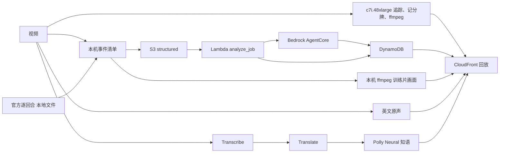

# 数据管道全景

> 2026-10-10 下午。账号 `382918437747`（profile `nba`，区域 `us-east-1`）。
> 这是步骤和 AWS 服务的对照。改了管道或换了服务，同一处改动里更新本文件和 `web/readme.html` 的「数据管道」。见仓库 `.cursor/rules/pipeline-map.mdc`。

事件只来自结构化清单。模型不看图编事件。页面中文音轨是英文解说的译文，不是模型看图写的。

## 步骤

| 步骤 | 做什么 | 现在跑在哪 | AWS 服务 | 状态 |
| --- | --- | --- | --- | --- |
| 1. 收片 | 训练片或考试片进入管道。上传页走预签名直传；`run_clip` 也可以直接读本地文件 | 本地命令，或浏览器 | S3 `raw/`、API Gateway `POST /jobs`、Lambda `create_job`、DynamoDB JobsTable、CloudFront | 主路径。栈 `Team04DeepCourt` 已创建，分配 `d2vzd2batw1eqe.cloudfront.net` 已部署 |
| 2. 追踪 | YOLO 检测 + ByteTrack，产出人和球的轨迹。一次看 16 帧，不跑球场关键点 | Batch 队列 `deepcourt-track` 保持一台 EC2 `c7i.48xlarge`。本机 MPS 仍能出训练片 | ECR `deepcourt-tracker:ready`、Batch、EC2 `c7i.48xlarge`、EBS gp3 1000GB、S3 `bootstrap/` 与 `tracking/` | 已接通。G/VT 配额为 0。标准配额 256 vCPU，单机用其中 192，并且保持开着。镜像已烤好。探测作业 `warm-probe` 写出 39 帧轨迹 |
| 3. 记分牌 | 读节次、比赛钟、进攻钟、比分。检测边长限制 640，避免整幅画面把 OCR 拖慢 | 考试片在同一台 `c7i.48xlarge` 上跑 `pipeline/vision/scoreboard.py`。训练片仍在本机 | Textract `DetectDocumentText` 只做过探测，不在主路径 | 已接通。`warm-probe` 读出 6 条比分条。训练片主路径仍在本地 |
| 4. 认人 | 号码 OCR，再对出场名单。躯干裁切的检测边长限制 192。已经跟上的那段轨迹写入清单 `players_full`，中间短空洞会补上；不把名字接到这段样本外面的同色队友身上 | 本地 `pipeline/vision/backtrack.py` | 无 | 本地 |
| 5. 事件清单 | 持球、传球、出手、回合。出手前后按原帧率重检，用球路找脱手那一帧，记下投篮人框。再从出手往前推 5 秒，按球衣颜色跟住投篮人，贴他最久的对方球员算领防人，再把他的轨迹接到出手帧；两人号码只在当时在场名单里认，票数不够就报号码没读出 | 本地 `pipeline/events`、`pipeline/vision/release.py` | 无 | 本地 |
| 6. 官方数据 | 用逐回合、boxscore、shot quality 补出手人、助攻、xFG、坐标。独行侠出手再贴 `data/2025-26/dal_margin_offense.json` 里、按当时分差取的赛季效率。对得上的人再贴 `data/deep` 的赛季出手质量、引力和关键度。每投再贴领防人和投篮人的本场对位、双方赛季场均和队内排名（`leaguedashplayerstats` 加同接口 Advanced 的真实命中率、防守效率；队内第 1 名五星，每往后一名少半星），和投篮人四场的分区预期命中率 | 本地 `pipeline/enrich`，读 `data/` 和仓库 `data/deep` | 无 | 本地。没有对上的比赛就跳过 |
| 7. 清单上云 | `structured/{jobId}.json` | S3 | S3 媒体桶 `team04deepcourt-mediabucketbcbb02ba-haisfxujonfg` | 主路径 |
| 8. 校验 | 取回清单并写成页面事件。Agent 不可用时 Lambda 直接读清单 | Lambda `analyze_job` | Bedrock AgentCore `DeepCourtAnalyst`、DynamoDB EventsTable、CloudWatch Logs | 主路径。这三项资源已创建 |
| 9. 回放 | 成片、时间线、暂停展开。进球后跳回出手帧定格 5 秒，投篮人脚下画红圈，弹出比分、投篮人和领防人的队内排名星级；领防人脚下画黄色虚线圈；领防人号码没读出就只写没读出；右栏是分区热区图，红圈标出这一投 | 浏览器。考试片的 mp4 和 `replay/clips.js` 用新文件名直传网页桶，只失效这几个路径 | CloudFront、S3 网页桶、API Gateway `GET /jobs/{id}` 与 `/events`、Lambda `get_job` `list_events` | 主路径。`/readme` 已能打开 |
| 10. 解说 | 页面可选两条音轨。英文音轨直接播原声。中文音轨用 Transcribe 转写英文解说，Translate 译成中文，再按原句的时间用 Polly 合成。原解说不留在中文音轨里。普通话只合成人声，因为现场声和原解说叠在一起，声道又几乎是单声道，分不开 | 云上作业在成片之后做。容器启动时从 S3 `bootstrap/track/` 拉 `run_job.py`、`dub.py`、`commentary.py`。训练片的两条音轨已经在网页桶 | Transcribe、Translate、Polly Neural `Zhiyu`（`cmn-CN`）、S3 `commentary/asr/`、任务角色 `TrackJobRole` | 部署中。下一支云上作业才会第一次在机器上跑完解说。GitHub 没有自动部署 |
| 11. 成片转码 | 人名烧进 MP4，写到网页桶 `assets/{jobId}-broadcast.mp4`。前 3 秒标出已回溯到的所有人，之后只标持球人、传球双方和领防人。训练片另出一份 `{clip}-replay.mp4`：进球后插入 5 秒出手帧定格 | 考试片在同一台 `c7i.48xlarge` 上用 ffmpeg。训练片仍是本机 ffmpeg | MediaConvert 模板 `deepcourt-render-template` | 已接通。`assets/warm-probe-broadcast.mp4` 已在网页桶。MediaConvert 还没有提交转码作业 |
| 12. 观测和密钥 | 看限流、放 webhook 和 token | 仪表盘和空密钥已建 | CloudWatch 仪表盘 `deepcourt-overview`、告警 `deepcourt-bedrock-throttles`、X-Ray、Secrets Manager `deepcourt/feishu-webhook` `deepcourt/github-token` `deepcourt/kuaishou`、Cost Explorer | 已接通。密钥仍是空占位。成本分配标签激活被拒绝。X-Ray 写过一条追踪 |

## 不在这条管道里

- Cognito 不建。回放和上传不登录。
- 快手 OAuth 代码在 `lambdas/kuaishou`。没有 app_id 时接口只返回敬请期待。
- 预置桶 `nba-hackathon-382918437747-team04` 只放过探测对象，不是媒体桶，也不是网页桶。

## 部署身份

profile `nba` 代入 `NBAHackathonParticipantRole`。CDK 栈名 `Team04DeepCourt`。标签 `team=04` `stage=prod` `project=deepcourt`。这个角色不能新建普通 IAM 角色，只能把 `NBAHackathonWorkloadRole` 传给受信任的服务。
