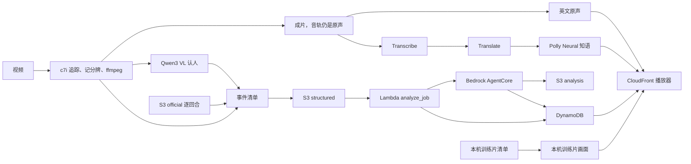

# 数据管道全景

> 2026-10-10 下午。账号 `382918437747`（profile `nba`，区域 `us-east-1`）。
> 这是步骤和 AWS 服务的对照。改了管道或换了服务，同一处改动里更新本文件和 `web/readme.html` 的「数据管道」。见仓库 `.cursor/rules/pipeline-map.mdc`。

事件只来自结构化清单。模型不看图编事件。页面中文音轨是英文解说的译文，不是模型看图写的。

云上新片子走上面一行：同一台机器认人、写事件清单，并从 S3 的官方逐回合对上比赛，成片出来之后再做两条音轨。训练片的领防、脱手帧和赛季对位仍在本机。

## 步骤

| 步骤 | 做什么 | 现在跑在哪 | AWS 服务 | 状态 |
| --- | --- | --- | --- | --- |
| 1. 收片 | 训练片或考试片进入管道。上传页走预签名直传；`run_clip` 也可以直接读本地文件 | 本地命令，或浏览器 | S3 `raw/`、API Gateway `POST /jobs`、Lambda `create_job`、DynamoDB JobsTable、CloudFront | 主路径。栈 `Team04DeepCourt` 已创建，分配 `d2vzd2batw1eqe.cloudfront.net` 已部署 |
| 2. 追踪 | YOLO 检测 + ByteTrack，产出人和球的轨迹。一次看 16 帧，不跑球场关键点 | Batch 队列 `deepcourt-track` 保持一台 EC2 `c7i.48xlarge`。本机 MPS 仍能出训练片 | ECR `deepcourt-tracker:ready`、Batch、EC2 `c7i.48xlarge`、EBS gp3 1000GB、S3 `bootstrap/` 与 `tracking/` | 已接通。G/VT 配额为 0。标准配额 256 vCPU，单机用其中 192，并且保持开着。镜像已烤好。探测作业 `warm-probe` 写出 39 帧轨迹 |
| 3. 记分牌 | 读节次、比赛钟、进攻钟、比分。检测边长限制 640，避免整幅画面把 OCR 拖慢 | 考试片在同一台 `c7i.48xlarge` 上跑 `pipeline/vision/scoreboard.py`。训练片仍在本机 | Textract `DetectDocumentText` 只做过探测，不在主路径 | 已接通。`warm-probe` 读出 6 条比分条。训练片主路径仍在本地 |
| 4. 认人 | 考试片把每条轨迹里框够大、重叠少的帧交给 Qwen3 VL 读号码和球衣颜色，多数票定号码。Rekognition 的读数算第二票。号码只在这一刻场上的同队 5 人里对，对不上就不写名字。同一个名字只留在票数最多的那条轨迹上。官方逐回合里的得分人、助攻人先钉。Textract 只在 Qwen 调用失败时兜底。训练片的身体坑和排除法仍在本机 `backtrack.py` | 考试片 `inference/chain.py`，模型 `qwen.qwen3-vl-235b-a22b`。场上 10 人由这场的逐回合换人推出来。训练片 `pipeline/vision/backtrack.py` | Bedrock Converse、Rekognition `DetectText`、S3 `official/` 与 `identity/`。Textract 不是主路径 | 已接通。`qwen-flagg` 第 1 秒写出克里斯蒂、史密斯、弗拉格，都在场上。认人多花 124 秒。训练片算法仍在本地 |
| 5. 事件清单 | 考试片按球在谁脚下，写出接球和传球，比分跳动再对上官方出手。清单落地后，AgentCore 分析师读这份清单，并写下回合解说。训练片仍在本机找脱手帧和领防人 | 考试片把 `structured/{jobId}.json` 写进媒体桶，S3 通知交给 `analyze_job`。解说写到 `analysis/{jobId}.json`。训练片 `pipeline/events`、`pipeline/vision/release.py` | S3 `structured/` 与 `analysis/`、Lambda `analyze_job`、Bedrock AgentCore、DynamoDB | 已接通。`warm-probe` 的清单是 3 条事件，Jobs 表状态 DONE。分析师解说见下面「智能体」。领防和脱手帧仍在本地 |
| 6. 官方数据 | 考试片从媒体桶读逐回合和 shot quality，用节次、比赛钟和比分对上是哪一场；比分有跳动时把是否命中、分值、助攻和预期命中率写进出手。训练片仍在本机读 `data/`，并补分差效率、引力和队内排名 | 考试片 `inference/chain.py` 读 `official/2025-26/`。训练片 `pipeline/enrich` | S3 `official/` | 已接通。探测片对上 `0022500356`。这 5 秒里比分没有跳动，所以没有出手行。训练片的其余官方字段仍在本地 |
| 7. 清单上云 | `structured/{jobId}.json` | S3 | S3 媒体桶 `team04deepcourt-mediabucketbcbb02ba-haisfxujonfg` | 主路径 |
| 8. 校验 | 取回清单、校验格式，写成页面事件。分析师另写解说。Agent 冷启动或调用失败时 Lambda 直接读清单写事件 | Lambda `analyze_job` | Bedrock AgentCore `DeepCourtAnalyst`、DynamoDB EventsTable、CloudWatch Logs、S3 `analysis/` | 主路径。事件写入已在用。分析师解说的状态见下面「智能体」 |
| 9. 回放 | 成片、时间线、暂停展开。进球后跳回出手帧定格 5 秒，投篮人脚下画红圈，弹出投篮人和领防人的队内排名星级（定格卡不再烧比分条）；领防人脚下画黄色虚线圈，领防名签贴在他躯干旁、背向投篮人一侧；领防人号码没读出就只写没读出；右栏是分区热区图，红圈标出这一投。站点本身在第 12 步 | 浏览器。考试片的 mp4 和 `replay/clips.js` 用新文件名直传网页桶，只失效这几个路径 | API Gateway `GET /jobs/{id}` 与 `/events`、Lambda `get_job` `list_events` | 主路径 |
| 10. 解说 | 页面上选两条音轨。英文是成片里的原声，不另处理。中文先把这条原声交给 Transcribe，再由 Translate 译成中文，按原句的时间用 Polly Neural 知语合成。原解说不留在中文音轨里。现场声和原解说叠在一起，声道又几乎是单声道，分不开，所以中文音轨只有合成人声 | 考试片：成片之后在同一容器里做。启动时从 S3 `bootstrap/track/` 拉脚本。训练片弗拉格、阿门的两条音轨已经在网页桶 | Transcribe、Translate、Polly Neural `Zhiyu`（`cmn-CN`）、S3 `commentary/asr/`、任务角色 `TrackJobRole` | 已接通。`warm-probe` 的中文音轨已在播放器里。训练片的两条音轨是本机做的 |
| 11. 成片转码 | 云上成片只把记分牌烧进 `assets/{jobId}-broadcast.mp4`，原声留在里面，不烧人名。训练片在本机另烧人名，并出 `{clip}-replay.mp4`：进球后插入 5 秒出手帧定格 | 考试片在同一台 `c7i.48xlarge` 上用 ffmpeg。训练片仍是本机 ffmpeg | MediaConvert 模板 `deepcourt-render-template` | 已接通。`assets/warm-probe-broadcast.mp4` 已在网页桶。MediaConvert 还没有提交转码作业 |
| 12. 网页呈现 | 评委打开的播放端和作品页。根路径是 `game.html`：成片、时间线、音轨选择。`/readme` 指到 `readme.html`。`/index.html` 只给自己上传，不作为提交链接。网页桶不公开，只经 CloudFront OAC 读取。`/api/*` 转到 API Gateway | 浏览器。CDK `DeployWeb` 把 `web/` 部署到网页桶 | CloudFront 分配 `Site`（`d2vzd2batw1eqe.cloudfront.net`）、S3 网页桶、CloudFront Function `ReadmePath` 与 `StripApiPrefix` | 主路径。`/` 和 `/readme` 已能打开 |
| 13. 观测和密钥 | 看限流、放 webhook 和 token | 仪表盘和空密钥已建 | CloudWatch 仪表盘 `deepcourt-overview`、告警 `deepcourt-bedrock-throttles`、X-Ray、Secrets Manager `deepcourt/feishu-webhook` `deepcourt/github-token` `deepcourt/kuaishou`、Cost Explorer | 已接通。密钥仍是空占位。成本分配标签激活被拒绝。X-Ray 写过一条追踪 |

## 智能体

Bedrock AgentCore 运行时 `DeepCourtAnalyst` 是 Deep Court 分析师。它用 Bedrock Converse 调 `global.anthropic.claude-sonnet-4-6`，自己决定先查事件清单、官方逐回合和 shot quality、赛季攻防三区，还是认人结果。清单格式校验仍是其中一个工具。解说只使用工具里查到的数字和人名，写到媒体桶 `analysis/{jobId}.json`。观众的问题走 `POST /agent/ask`（页面上是 `/api/agent/ask`），还是同一个运行时。

`analyze_job` 在 `structured/` 落地后调用它。运行时冷启动或调用失败时，Lambda 仍直接读清单，把页面事件写入 DynamoDB。

下午探测时，运行时 30 秒内没有完成初始化。直接代码部署不会在启动时安装 `requirements.txt`，入口却导入了没有打进 zip 的 `bedrock-agentcore`，进程一起床就退出。平台把这个错误报成初始化超时。现在入口只用 Python 标准库先听 `/ping`，boto3 由 CDK 打进代码包，第一次分析才加载。

状态：部署中。代码在仓库里，还没有用这次的模板执行 `cdk deploy`。

## 不在这条管道里

- Cognito 不建。回放和上传不登录。
- 快手 OAuth 代码在 `lambdas/kuaishou`。没有 app_id 时接口只返回敬请期待。
- 预置桶 `nba-hackathon-382918437747-team04` 只放过探测对象，不是媒体桶，也不是网页桶。

## 部署身份

profile `nba` 代入 `NBAHackathonParticipantRole`。CDK 栈名 `Team04DeepCourt`。标签 `team=04` `stage=prod` `project=deepcourt`。这个角色不能新建普通 IAM 角色，只能把 `NBAHackathonWorkloadRole` 传给受信任的服务。
