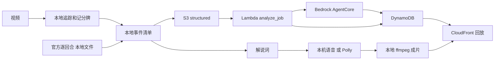

# 数据管道全景

> 2026-10-10 上午。账号 `382918437747`（profile `nba`，区域 `us-east-1`）。
> 这是步骤和 AWS 服务的对照。改了管道或换了服务，同一处改动里更新本文件和 `web/readme.html` 的「数据管道」。见仓库 `.cursor/rules/pipeline-map.mdc`。

事件只来自结构化清单。模型不看图编事件。Claude Sonnet 4.6 只根据清单写两句解说。

## 步骤

| 步骤 | 做什么 | 现在跑在哪 | AWS 服务 | 状态 |
| --- | --- | --- | --- | --- |
| 1. 收片 | 训练片或考试片进入管道。上传页走预签名直传；`run_clip` 也可以直接读本地文件 | 本地命令，或浏览器 | S3 `raw/`、API Gateway `POST /jobs`、Lambda `create_job`、DynamoDB JobsTable、CloudFront | 主路径。栈 `Team04DeepCourt` 已创建，分配 `d2vzd2batw1eqe.cloudfront.net` 已部署 |
| 2. 追踪 | YOLO 检测 + ByteTrack，产出人和球的轨迹 | 本地 `pipeline/vision` | 无。计划是 ECR `deepcourt-tracker`、Batch 队列 `deepcourt-track`、EC2 `g4dn.xlarge`、EBS gp3 | 主路径在本地。ECR 仓库已建、镜像未推。G/VT 按需配额为 0，实例没开 |
| 3. 记分牌 | 读节次、比赛钟、进攻钟、比分 | 本地 RapidOCR，`pipeline/vision/scoreboard.py` | Textract `DetectDocumentText` 只做过探测，不在主路径 | 主路径在本地 |
| 4. 认人 | 号码 OCR，再对出场名单 | 本地 | 无 | 本地 |
| 5. 事件清单 | 持球、传球、出手、回合 | 本地 `pipeline/events` | 无 | 本地 |
| 6. 官方数据 | 用逐回合、boxscore、shot quality 补出手人、助攻、xFG、坐标 | 本地 `pipeline/enrich`，读 `data/` | 无 | 本地。没有对上的比赛就跳过 |
| 7. 清单上云 | `structured/{jobId}.json` | S3 | S3 媒体桶 `team04deepcourt-mediabucketbcbb02ba-haisfxujonfg` | 主路径 |
| 8. 校验 | 取回清单并写成页面事件。Agent 不可用时 Lambda 直接读清单 | Lambda `analyze_job` | Bedrock AgentCore `DeepCourtAnalyst`、DynamoDB EventsTable、CloudWatch Logs | 主路径。这三项资源已创建 |
| 9. 回放 | 成片、时间线、暂停展开 | 浏览器 | CloudFront、S3 网页桶、API Gateway `GET /jobs/{id}` 与 `/events`、Lambda `get_job` `list_events` | 主路径。`/readme` 已能打开 |
| 10. 解说 | 两句中文，混进成片 | 词可以由 Bedrock 写；当前成片声音是本机语音，ffmpeg 混音 | Bedrock Claude Sonnet 4.6、Polly Zhiyu、S3 `commentary/` | Polly 已合成过一段探测 MP3。成片还没用这段声音 |
| 11. 成片转码 | 叠加层烧进 1080p MP4 | 本地 ffmpeg | MediaConvert 模板 `deepcourt-render-template` | 模板已建。还没有提交转码作业 |
| 12. 观测和密钥 | 看限流、放 webhook 和 token | 仪表盘和空密钥已建 | CloudWatch 仪表盘 `deepcourt-overview`、告警 `deepcourt-bedrock-throttles`、X-Ray、Secrets Manager `deepcourt/feishu-webhook` `deepcourt/github-token` `deepcourt/kuaishou`、Cost Explorer | 已接通。密钥仍是空占位。成本分配标签激活被拒绝。X-Ray 写过一条追踪 |

## 不在这条管道里

- Cognito 不建。回放和上传不登录。
- 快手 OAuth 代码在 `lambdas/kuaishou`。没有 app_id 时接口只返回敬请期待。
- 预置桶 `nba-hackathon-382918437747-team04` 只放过探测对象，不是媒体桶，也不是网页桶。

## 部署身份

profile `nba` 代入 `NBAHackathonParticipantRole`。CDK 栈名 `Team04DeepCourt`。标签 `team=04` `stage=prod` `project=deepcourt`。这个角色不能新建普通 IAM 角色，只能把 `NBAHackathonWorkloadRole` 传给受信任的服务。
