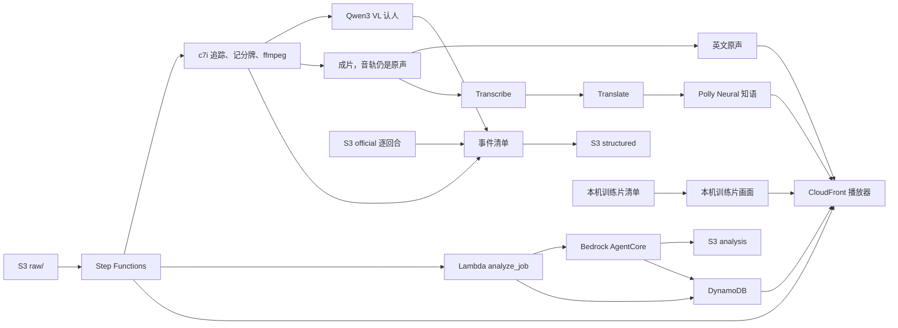

# 数据管道全景

> 2026-10-10 下午。账号 `382918437747`（profile `nba`，区域 `us-east-1`）。
> 这是步骤和 AWS 服务的对照。改了管道或换了服务，同一处改动里更新本文件和 `web/readme.html` 的「数据管道」。见仓库 `.cursor/rules/pipeline-map.mdc`。

事件只来自结构化清单。模型不看图编事件。页面中文音轨是英文解说的译文，不是模型看图写的。

云上新片子走上面一行：`raw/` 上传只启动状态机 `deepcourt-film`。状态机改任务状态、提交 Batch 并等到结束，再调用 `analyze_job`，然后核对网页桶里的成片和 `replay/clips.js` 并失效这几个路径。同一台机器认人、写事件清单，并从 S3 的官方逐回合对上比赛，成片出来之后再做两条音轨。训练片的领防、脱手帧和赛季对位仍在本机。这次栈更新还没部署，今晚考试片仍走现有作业定义。

## 步骤

| 步骤 | 做什么 | 现在跑在哪 | AWS 服务 | 状态 |
| --- | --- | --- | --- | --- |
| 1. 收片 | 训练片或考试片进入管道。上传页走预签名直传；`run_clip` 也可以直接读本地文件 | 本地命令，或浏览器。部署后，`raw/` 对象创建由 EventBridge 启动状态机，`create_job` 不提交 Batch | S3 `raw/`、API Gateway `POST /jobs`、Lambda `create_job`、DynamoDB JobsTable、CloudFront、EventBridge | 主路径。栈 `Team04DeepCourt` 已创建，分配 `d2vzd2batw1eqe.cloudfront.net` 已部署 |
| 编排 | 上传之后只走一条路：改 Jobs 状态、提交 Batch 并等待、调用 `analyze_job`、核对成片和片单、失效 CloudFront 上这一支片子的路径。失败写成 FAILED 并记下步骤。同一次上传的重复事件会被 DynamoDB 条件挡住 | 状态机 `deepcourt-film`（标准工作流），代码在 `cdk/lib/orchestration.ts`。`-c enableOrchestration=false` 时不接 EventBridge，S3 仍通知 `analyze_job` | Step Functions、EventBridge、DynamoDB、Batch、Lambda `analyze_job`、S3、CloudFront | 部署中 |
| 2. 追踪 | YOLO 检测 + ByteTrack，产出人和球的轨迹。一次看 16 帧，不跑球场关键点 | 部署后由状态机对队列 `deepcourt-track` 做 `SubmitJob.sync`。部署前仍是手工 `submit-job`。`SubmitTrack` 没有事件源。本机 MPS 仍能出训练片 | ECR `deepcourt-tracker:ready`、Batch、EC2 `c7i.48xlarge`、EBS gp3 1000GB、S3 `bootstrap/track/` 与 `tracking/` | 已接通。G/VT 配额为 0。标准配额 256 vCPU，单机用其中 192，并且保持开着。镜像已烤好。探测作业 `warm-probe` 写出 39 帧轨迹 |
| 3. 记分牌 | 读节次、比赛钟、进攻钟、比分。检测边长限制 640，避免整幅画面把 OCR 拖慢 | 考试片在同一台 `c7i.48xlarge` 上跑 `pipeline/vision/scoreboard.py`。训练片仍在本机 | Textract `DetectDocumentText` 只做过探测，不在主路径 | 已接通。`warm-probe` 读出 6 条比分条。训练片主路径仍在本地 |
| 4. 认人 | 检测器标成裁判（`Ref`）的框不进轨迹。考试片把每条轨迹里框够大、重叠少的帧交给 Qwen3 VL 读号码和球衣颜色，多数票定号码。Rekognition 的读数算第二票。哪种球衣颜色属于哪一队由程序自己判断：每种颜色下读到的号码去对官方逐回合推出的场上 10 人，哪一队独有的号码重合多就归哪一队；`TEAM_COLORS` 只在判断不出时兜底，默认不设。Qwen 说是裁判、或裁判读到过的号码按颜色对不上场上的人，那段轨迹切出来，不投票也不挂标签。号码只在球衣颜色那一队这一刻的场上 5 人里对。同一个名字的碎轨迹在时间上不重叠就接成一个人，没有名字的碎轨迹接到前后 1 秒内、位置挨着的同队轨迹上。名签贴在头顶上方，最多上挪一行，放不下就不画 Agent detecting；比场上最靠上的已认出球员还高一截的框在看台上，不挂；切到特写或慢镜头后不挂，要连着 1 秒回到全景才恢复。领防按轨迹距离算：主攻是下一次出手的投篮人，领防是离他脚下最近的对方球员，新的人要连续 1.5 秒都明显更近才换，挡拆挡开一下不换。Qwen 和 Rekognition 用线程池并发调用，默认 16 路（`IDENTITY_WORKERS` 最多 32），被限流退避重试 3 次，仍失败就当这一帧读不出；收齐后按原顺序投票。`SKIP_REKOGNITION=1` 只用 Qwen 投票。重跑时 `REUSE_TRACKS=1` 直接读上一次留在 S3 的轨迹和记分牌读数，从认人往下跑，找不到就完整重跑。分得出队但没有名字的人，标签只写 Agent detecting，颜色用队色；分不出队的不挂。官方逐回合里的得分人、助攻人先钉。Textract 只在 Qwen 调用失败时兜底。训练片的身体坑和排除法仍在本机 `backtrack.py` | 考试片 `inference/chain.py`，模型 `qwen.qwen3-vl-235b-a22b`。场上 10 人由这场的逐回合换人推出来。训练片 `pipeline/vision/backtrack.py` | Bedrock Converse、Rekognition `DetectText`、S3 `official/` 与 `identity/`。Textract 不是主路径 | 已接通。`qwen-flagg` 第 1 秒写出小史密斯、弗拉格，都在场上，裁判身上不挂标签。其余分得出队的 4 人挂 Agent detecting。整段 10 个名字各一条轨迹，球衣颜色都和队一致。认人多花 114 秒。训练片算法仍在本地 |
| 5. 事件清单 | 考试片里谁、什么动作看官方逐回合，什么时候看画面。比分跳动后往回找比赛钟停住的那一刻，进攻钟读得到时用它把停表时刻定准，再减去记分员的反应时间，作为出手和定格的时刻；钟没停时用进攻钟复位往回推。片段内的盖帽、篮板、犯规按记分牌换算成画面时刻，篮板从被盖后找球重新被人抱住的那一帧。加罚这类片内没出现过比分的不写。传球只留进攻方两个都认出来、相隔 1.2 秒以上的换手。清单落地后，AgentCore 分析师读这份清单，并写下回合解说。训练片仍在本机找脱手帧和领防人 | 考试片把 `structured/{jobId}.json` 写进媒体桶。部署后由状态机调用 `analyze_job`，`structured/` 不再发 S3 通知。解说写到 `analysis/{jobId}.json`。训练片 `pipeline/events`、`pipeline/vision/release.py` | S3 `structured/` 与 `analysis/`、Lambda `analyze_job`、Bedrock AgentCore、DynamoDB | 已接通。`warm-probe` 的清单是 3 条事件，Jobs 表状态 DONE。分析师解说见下面「智能体」。领防和脱手帧仍在本地 |
| 6. 官方数据 | 考试片从媒体桶读逐回合和 shot quality，用节次、比赛钟和比分对上是哪一场；每次出手写进是否命中、分值、距离、预期命中率、盖帽人和犯规人，从 matchups 查投篮人被场上哪位防得最多，从 shot quality 查全队平均预期命中率。训练片仍在本机读 `data/`，并补分差效率、引力和队内排名 | 考试片 `inference/chain.py` 读 `official/2025-26/`。训练片 `pipeline/enrich` | S3 `official/` | 已接通。探测片对上 `0022500356`。这 5 秒里比分没有跳动，所以没有出手行。训练片的其余官方字段仍在本地 |
| 7. 清单上云 | `structured/{jobId}.json` | S3 | S3 媒体桶 `team04deepcourt-mediabucketbcbb02ba-haisfxujonfg` | 主路径 |
| 8. 校验 | 取回清单、校验格式，写成页面事件。分析师另写解说。Agent 冷启动或调用失败时 Lambda 直接读清单写事件 | Lambda `analyze_job`。部署后只由状态机调用。`-c enableOrchestration=false` 时仍由 `structured/` 的 S3 通知调用 | Bedrock AgentCore `DeepCourtAnalyst`、DynamoDB EventsTable、CloudWatch Logs、S3 `analysis/` | 主路径。事件写入已在用。分析师解说的状态见下面「智能体」 |
| 9. 回放 | 成片、时间线、暂停展开。进球后跳回出手帧定格 5 秒，投篮人脚下画红圈，弹出投篮人和领防人的队内排名星级（定格卡不再烧比分条）；领防人脚下画黄色虚线圈，领防名签贴在他躯干旁、背向投篮人一侧；领防人号码没读出就只写没读出；右栏是分区热区图，红圈标出这一投。站点本身在第 12 步 | 浏览器。考试片的 mp4 和 `replay/clips.js` 用新文件名直传网页桶，只失效这几个路径 | API Gateway `GET /jobs/{id}` 与 `/events`、Lambda `get_job` `list_events` | 主路径 |
| 10. 解说 | 页面上选两条音轨。考试片按事件清单写中英文解说稿：开场交代节次、时间和比分，每个官方动作一句，再插预期命中率、全队平均和对位这些数；两句之间空出 5 秒以上就补一句谁在持球、谁在防他。Polly Neural 知语读中文、Matthew 读英文，原片声音压到 12% 只当现场环境声，不和配音抢。解说稿配不出来时，退回旧办法：Transcribe 转写原解说，Translate 译成中文 | 考试片：成片之后在同一容器里做。启动时从 S3 `bootstrap/track/` 拉脚本。CDK 把仓库里的 `run_job.py`、`chain.py`、`dub.py` 和 `commentary.py`（即 `pipeline/present/tracks.py`）传到这个前缀。训练片弗拉格、阿门的两条音轨已经在网页桶 | Transcribe、Translate、Polly Neural `Zhiyu`（`cmn-CN`）、S3 `commentary/asr/` 与 `bootstrap/track/`、任务角色 `TrackJobRole` | 已接通。`warm-probe` 的中文音轨已在播放器里。训练片的两条音轨是本机做的 |
| 11. 成片转码 | 云上成片把记分牌和名签烧进 `assets/{jobId}-broadcast.mp4`，原声留在里面。名签用队色，领防用黄色并写「领防」；切到特写或观众镜头的帧不画名签。原片之后接精彩回放（`inference/highlights.py`）：封盖和 3+1 各一段，每段正好 5 秒，出手前 1.5 秒慢放到 3 秒，在球离手那一帧定格 2 秒，定格时左右贴进攻卡和防守卡（`card_layout.place_cards`，进攻卡远离篮筐、防守卡靠近篮筐，带队内星级），回放里的名签来自成片，只有一层；回放段静音，配音只铺在原片上。回放出错或时长不对就照发原片，此时卡片烧在原片出手前后。成片和中英文两条配音同时做，成片出来后两支带配音的 mp4 同时封装，任何一支失败整步报错，不只发一部分。训练片在本机另烧人名，并出 `{clip}-replay.mp4`：进球后插入 5 秒出手帧定格 | 考试片在同一台 `c7i.48xlarge` 上用 ffmpeg。训练片仍是本机 ffmpeg | MediaConvert 模板 `deepcourt-render-template` | 已接通。`assets/warm-probe-broadcast.mp4` 已在网页桶。MediaConvert 还没有提交转码作业 |
| 12. 网页呈现 | 评委打开的播放端和作品页。根路径是 `game.html`：成片、时间线、音轨选择。`/readme` 指到 `readme.html`。`/index.html` 只给自己上传，不作为提交链接。网页桶不公开，只经 CloudFront OAC 读取。`/api/*` 转到 API Gateway | 浏览器。CDK `DeployWeb` 把 `web/` 部署到网页桶 | CloudFront 分配 `Site`（`d2vzd2batw1eqe.cloudfront.net`）、S3 网页桶、CloudFront Function `ReadmePath` 与 `StripApiPrefix` | 主路径。`/` 和 `/readme` 已能打开 |
| 13. 观测和密钥 | 看限流、放 webhook 和 token。同一张仪表盘加上状态机执行成功、失败和耗时 | 仪表盘和空密钥已建 | CloudWatch 仪表盘 `deepcourt-overview`、告警 `deepcourt-bedrock-throttles`、X-Ray、Secrets Manager `deepcourt/feishu-webhook` `deepcourt/github-token` `deepcourt/kuaishou`、Cost Explorer | 已接通。密钥仍是空占位。成本分配标签激活被拒绝。X-Ray 写过一条追踪 |

## 智能体

Bedrock AgentCore 运行时 `DeepCourtAnalyst` 是 Deep Court 分析师。它用 Bedrock Converse 调 `global.anthropic.claude-sonnet-4-6`，自己决定先查事件清单、官方逐回合和 shot quality、赛季攻防三区，还是认人结果。清单格式校验仍是其中一个工具。解说只使用工具里查到的数字和人名，写到媒体桶 `analysis/{jobId}.json`。观众的问题走 `POST /agent/ask`（页面上是 `/api/agent/ask`），还是同一个运行时。

部署后，状态机在 Batch 成功时调用 `analyze_job`，再由它叫醒分析师。`structured/` 不再发 S3 通知。`-c enableOrchestration=false` 时仍由这个通知叫醒。运行时冷启动或调用失败时，Lambda 仍直接读清单，把页面事件写入 DynamoDB。

下午探测时，运行时 30 秒内没有完成初始化。直接代码部署不会在启动时安装 `requirements.txt`，入口却导入了没有打进 zip 的 `bedrock-agentcore`，进程一起床就退出。平台把这个错误报成初始化超时。现在入口只用 Python 标准库先听 `/ping`，boto3 由 CDK 打进代码包，第一次分析才加载。

状态：部署中。代码在仓库里，还没有用这次的模板执行 `cdk deploy`。

## 不在这条管道里

- Cognito 不建。回放和上传不登录。
- 快手 OAuth 代码在 `lambdas/kuaishou`。没有 app_id 时接口只返回敬请期待。
- 预置桶 `nba-hackathon-382918437747-team04` 只放过探测对象，不是媒体桶，也不是网页桶。

## 部署身份

profile `nba` 代入 `NBAHackathonParticipantRole`。CDK 栈名 `Team04DeepCourt`。标签 `team=04` `stage=prod` `project=deepcourt`。这个角色不能新建普通 IAM 角色，只能把 `NBAHackathonWorkloadRole` 传给受信任的服务。
